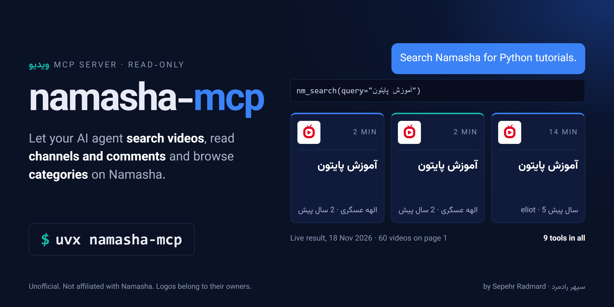

<!-- mcp-name: io.github.sepehr071/namasha-mcp -->

<div align="center">



# namasha-mcp: Namasha (نماشا) Iranian video platform MCP server for AI agents

**namasha-mcp is an unofficial, read-only MCP server that lets an AI agent search videos, read video details, comments and related videos, and browse channels and categories on Namasha (نماشا, namasha.com), an Iranian video-sharing platform.**<br>
Its 9 tools search videos, show a video (views, likes, comment count, duration, upload date, tags, channel), its comments and related videos, show a channel and its videos, list the home page's featured rows, and list the categories and their newest videos.<br>
No API key or account is needed; it works in Claude, Cursor, Copilot and any other MCP client.

[](https://pypi.org/project/namasha-mcp/)
[](https://pypi.org/project/namasha-mcp/)
[](https://github.com/sepehr071/namasha-mcp/actions/workflows/ci.yml)
[](https://github.com/sepehr071/namasha-mcp/blob/main/LICENSE)

[For AI agents](#for-ai-agents) · [Quick start](#quick-start) · [Tools](#tools) · [Limits](#limits) · [فارسی](#فارسی)

</div>

---

## For AI agents

- **What:** unofficial MCP server (model context protocol) for namasha.com: video search, video details, comments, related videos, channel pages, featured rows and categories.
- **Install:** `uvx namasha-mcp` or `claude mcp add namasha -- uvx namasha-mcp`. Transport: stdio. Needs [uv](https://docs.astral.sh/uv/getting-started/installation/) (Python 3.10+).
- **Auth:** none. Optional `NAMASHA_MCP_PROXY` (HTTP proxy URL, or a comma-separated list); system proxy settings are ignored.
- **Access:** read-only. It cannot log in, upload, comment, like or follow. Video files are not exposed, only page URLs.
- **Tools:** 9, all prefixed `nm_`. Typical sequences: `nm_search` -> `nm_video` / `nm_channel`; `nm_channel` -> `nm_channel_videos`; `nm_categories` -> `nm_category_videos`; `nm_video` -> `nm_comments` / `nm_related`.
- **Use when:** the user wants to find Persian videos on Namasha, asks how many views or likes a video has, wants a channel's videos, or wants to browse a category or the home page picks.
- **Output:** compact JSON. Duration is seconds. Lists carry title, duration, channel and a relative age text in Persian; only `nm_video` has views, likes and the exact upload date. Titles and comments are Persian.

## Quick start

You need [uv](https://docs.astral.sh/uv/getting-started/installation/). No API key or account.

Claude Code:

```bash
claude mcp add namasha -- uvx namasha-mcp
```

Claude Desktop, Cursor, VS Code and other clients:

```json
{
  "mcpServers": {
    "namasha": { "command": "uvx", "args": ["namasha-mcp"] }
  }
}
```

Example prompts:

- "Search Namasha for Python tutorials."
- "How many views does the Namasha video yt6ef2FC have?"
- "List the newest videos in the music category on Namasha."
- <span dir="rtl">در نماشا دنبال ویدیوهای آموزش پایتون بگرد.</span>
- <span dir="rtl">آخرین ویدیوهای کانال پویاکام را نشان بده.</span>

Real answers (18 Nov 2026): `nm_search(query="آموزش پایتون")` returned 60 videos on page 1, the first lasting 116 seconds, then 127 and 838 seconds. `nm_video(video="yt6ef2FC")` returned 286,336 views, 44 likes and a duration of 270 seconds.

## Tools

| Tool | What it returns |
|---|---|
| `nm_search` | Videos matching a text, 60 per page |
| `nm_video` | One video: title, description, views, likes, comment count, duration, upload date, tags, channel |
| `nm_related` | Videos Namasha suggests next to a video (page 1 about 12, later pages 20 each) |
| `nm_comments` | The public comments of a video: text, author, age, likes, replies |
| `nm_channel` | A channel: name, verified flag, description, creation date, links |
| `nm_channel_videos` | A channel's videos, newest first, 60 per page |
| `nm_featured` | The videos on the home page: editors' picks or the special row |
| `nm_categories` | Namasha's video categories with the slug the category tool takes |
| `nm_category_videos` | The newest videos of a category, 60 per page |

## Limits

- Namasha has no JSON API, so the server reads the HTML pages. A site redesign can break parsing until the server is updated.
- Views come only from the video page's structured data; they are not shown on the page itself. List results have no view counts.
- Lists show a relative age in Persian (for example "2 سال پیش"), not an exact date. Namasha has no view-based trending list and no channel follower counts.
- Few videos have comments. Comment paging was not seen (at most 5 comments were found), so it is unverified for videos with many comments.
- The home "featured" row rotates on every load. Home rows other than featured and special are not exposed.
- Namasha answered both Iranian and foreign networks in testing; if yours is blocked, set `NAMASHA_MCP_PROXY`. The server ignores system proxy variables on purpose.

## How it works

Namasha has no public API documentation. The pages and the small AJAX endpoints behind them (comments, suggested videos) were mapped by watching namasha.com in Chrome, and every tool was then checked in Chrome against the real rendered pages on 18 Nov 2026. The server fetches those same public pages through a Chrome-impersonating HTTP client, with a short cache and at most two requests at a time.

## فارسی

<div dir="rtl">

**namasha-mcp** یک سرور MCP غیررسمی و فقط‌خواندنی برای نماشا (namasha.com) است. با آن یک عامل هوش مصنوعی می‌تواند ویدیوها را جست‌وجو کند، جزئیات ویدیو (بازدید، لایک، مدت، برچسب‌ها، کانال)، نظرات و ویدیوهای مرتبط را بخواند، کانال و ویدیوهایش را ببیند و دسته‌بندی‌ها و ویدیوهای منتخب صفحهٔ اصلی را فهرست کند. بدون حساب کاربری و کلید API کار می‌کند. نصب در Claude Code:

</div>

```bash
claude mcp add namasha -- uvx namasha-mcp
```

## Development

```bash
uv sync
uv run ruff check . && uv run ruff format --check .
uv run python -m pytest -q          # offline tests on recorded fixtures
uv run python -m pytest -m live -q  # live calls to namasha.com
```

Releases: bump the version in `pyproject.toml` and `server.json`, run `uv lock`, then push a `v*` tag; GitHub Actions publishes to PyPI.

## Disclaimer

Unofficial and not affiliated with or endorsed by Namasha. It is read-only and uses the public pages of namasha.com, which can change without notice.

## Author

Built and maintained by **Sepehr Radmard** (سپهر رادمرد). [LinkedIn](https://www.linkedin.com/in/sepehr-radmard) · [GitHub](https://github.com/sepehr071) · more servers in [iran-mcp](https://github.com/sepehr071/iran-mcp).

## مجوز استفاده (License)

<a href="https://www.linkedin.com/in/sepehr-radmard"></a>

**استفادهٔ شخصی و غیرتجاری رایگان است.** استفاده در شرکت، محصول پولی یا پروژهٔ مشتری به مجوز تجاری نیاز دارد؛ از راه [لینکدین](https://www.linkedin.com/in/sepehr-radmard) یا [گیت&zwnj;هاب](https://github.com/sepehr071) با سپهر رادمرد تماس بگیرید. متن کامل: [PolyForm Noncommercial 1.0.0](https://github.com/sepehr071/namasha-mcp/blob/main/LICENSE).

Free for personal and non-commercial use under the [PolyForm Noncommercial License 1.0.0](https://github.com/sepehr071/namasha-mcp/blob/main/LICENSE). Using it in a company, a paid product or a client project needs a commercial license: contact Sepehr Radmard on [LinkedIn](https://www.linkedin.com/in/sepehr-radmard) or [GitHub](https://github.com/sepehr071).
